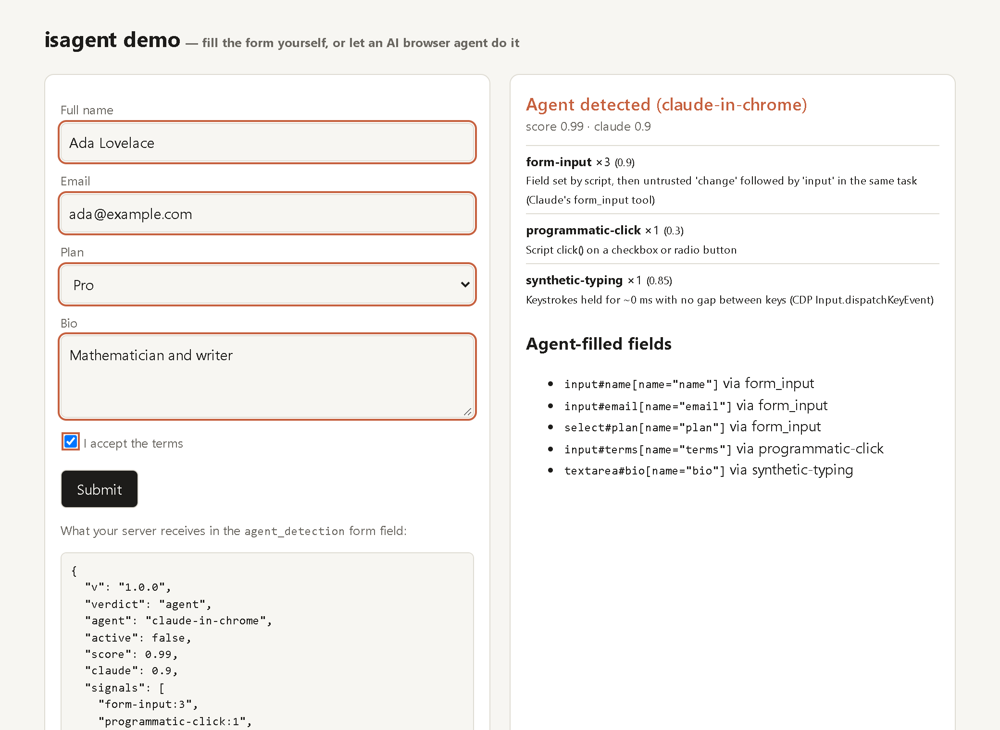

# isagent

**Like [`isbot`](https://github.com/omrilotan/isbot), but for AI browser agents.** Know when Claude in Chrome or another agent is using your website, and which form fields it filled.

[](https://github.com/ilslaoaycd/isagent/actions/workflows/ci.yml)
[](https://www.npmjs.com/package/isagent.js)
[](dist/isagent.min.js)
[](LICENSE)

**[Live demo](https://ilslaoaycd.github.io/isagent/demo/)** · **[How to detect Claude in Chrome](https://ilslaoaycd.github.io/isagent/)** · [npm](https://www.npmjs.com/package/isagent.js)

```js
if (isagent.isAgent()) { /* an AI agent is driving this page */ }
```

`isagent` is a small, dependency-free script for the browser. `isbot` reads the user-agent string, but browser agents like Claude in Chrome run in a normal Chrome with the person's own user agent, cookies and IP. `isagent` watches what actually happens on the page instead. It detects **Claude in Chrome** specifically and other CDP-driven agents (Puppeteer/Playwright-style automation, Browser Use, ChatGPT agent) generically. It also tells you *how* each field was filled. Your server receives the result with the form, and no data leaves your site.



- **Precise for Claude in Chrome.** It recognises the agent's overlay, its live Stop button, its `form_input` tool, and its keystroke and click patterns. Verified against the real extension, and the test suite runs the extension's own code when it's installed.
- **Per-field attribution.** For example `input#email` via `form_input`, `textarea#bio` via `synthetic-typing`. Use it to ask for confirmation of exactly the fields an agent touched.
- **Works where sites actually have forms.** Shadow DOM web components, same-origin iframes, `fetch` + `FormData` single-page apps, and `form.submit()`.
- **Low false positives.** Timing uses browser event timestamps, so busy pages don't make people look like bots. Tests cover busy main threads, page scripts that reformat fields, quick touchpad taps and human-paced input.
- **Tiny and private.** ~7 KB gzipped, no network requests, no cookies or storage. The summary sent to your server lists fields and methods, never values.

## How to detect Claude in Chrome

Your server can't: Claude in Chrome runs inside the visitor's own Chrome, with their user agent, cookies and IP. A script in the page can, because Claude leaves three traces:

1. **Its overlay.** An attribute-less `<div>` on `<body>` holds Claude's glow, cursor and Stop button in a **closed shadow root**. Older selectors such as `#claude-agent-stop-container` no longer match since version 1.0.107.
2. **Its `form_input` tool.** It fires an untrusted `change` event *before* `input`, which is the reverse of real typing and normal scripts.
3. **Machine timing.** Keys are held for under a millisecond, and clicks jump to the target with no movement trail.

`isagent` checks all three and tells you which fields Claude filled. To see it in action, open the [live demo](https://ilslaoaycd.github.io/isagent/demo/) and ask Claude in Chrome to fill in the form. The full explanation is in [How to detect Claude in Chrome](https://ilslaoaycd.github.io/isagent/).

## Install

```html
<!-- in <head>, before your other scripts -->
<script src="https://cdn.jsdelivr.net/npm/isagent.js@1/dist/isagent.min.js"></script>
<script>
  const detector = isagent.start({ formField: "agent_detection" });
</script>
```

or

```sh
npm install isagent.js
```

```js
import { start } from "isagent.js";
export const detector = start({ formField: "agent_detection" });
```

Load it as early as you can. It only sees what happens after it starts, except for Claude's overlay, which stays in the page.

For a quick yes/no, call `isagent.isAgent()`. It uses the running detector if there is one. Otherwise it checks what's visible right now: Claude's overlay, agent markers and automation globals.

## Use it

**1. Receive the result with every form.** With `formField` set, every `FormData` built from a form gets an extra field. That covers normal submits, `form.submit()`, and `fetch(url, { body: new FormData(form) })`.

```json
{
  "v": "1.0.0",
  "verdict": "agent",
  "agent": "claude-in-chrome",
  "active": true,
  "score": 0.999,
  "claude": 0.999,
  "signals": ["overlay-host:1", "form-input:2", "synthetic-typing:1"],
  "fields": ["input#email[name=\"email\"]:form_input", "textarea#bio[name=\"bio\"]:synthetic-typing"]
}
```

For JSON APIs, send it yourself:

```js
await fetch("/api/signup", {
  method: "POST",
  headers: { "content-type": "application/json" },
  body: JSON.stringify({ ...data, agentDetection: detector.summary(formElement) }),
});
```

**2. Decide on the server.** The value comes from the browser, so treat it as a signal, not proof:

```js
const d = safeJson(req.body.agent_detection);
if (d?.verdict === "agent") {
  // e.g. send a confirmation email, hold for review, require a human step for the fields in d.fields
}
```

A missing field tells you nothing either way. It can be stripped, or JavaScript may be off.

**3. React in the page (optional).**

```js
isagent.start({
  onDetect: (report) => showBanner(`Filled by ${report.agent}. Please review before sending.`),
  onFieldFill: ({ element, method }) => element.classList.add("agent-filled"),
  onActiveChange: (active) => console.log("Claude is acting on this page:", active),
});

detector.agentFill(document.querySelector("#email")); // { method: "form_input", ... } or null
window.addEventListener("isagent:detect", (e) => console.log(e.detail.report));
```

## What it detects

| Signal | Identifies | Weight | How |
|---|---|---|---|
| `overlay-host` | Claude in Chrome | 0.95 | An attribute-less `<div>` on `<body>` holding a **closed** shadow root (Claude's glow, cursor and Stop button). Recognised by structure, not ids, and confirmed by `attachShadow()` throwing. The element stays after the agent finishes. |
| `overlay-active` | Claude in Chrome | 0.99 | Claude's Stop button and status tag take pointer events, so `elementsFromPoint()` finds the overlay while Claude is working. This powers the live `active` flag. |
| `overlay-activity` | Claude in Chrome | 0.97 | The overlay re-attaches itself to the end of `<body>` when indicators are rebuilt. |
| `legacy-marker` | Claude in Chrome | 0.95 | Ids that earlier versions put directly in the page, e.g. `#claude-agent-stop-container`. |
| `tab-icon` | Claude in Chrome | 0.95 | Favicon swapped for Claude's cursor icon (a feature-flagged behaviour). |
| `form-input` | Claude in Chrome | 0.9 | Claude's `form_input` sets the value, then dispatches untrusted `change` **before** `input` in one task. Browsers and normal scripts do the opposite. |
| `agent-marker` | other agents | 0.9 | DOM markers publicly reported for ChatGPT agent, Browser Use and Playwright (not verified by this project). |
| `automation-globals` | generic | 0.9 | `navigator.webdriver`, ChromeDriver `cdc_` variables, Playwright/Selenium/Puppeteer globals. |
| `synthetic-typing` | generic | 0.85 | Keys held for ~0 ms with no gap, from CDP `Input.dispatchKeyEvent`. Two keys are enough. |
| `teleport-click` | generic | 0.6 | The pointer appeared on the target in one jump, then pressed and released within milliseconds. |
| `synthetic-fill` | generic | 0.4 | Value changed through script-dispatched events with no recent user input. |
| `insert-text` | generic | 0.35 | Text inserted with no key press, paste or IME composition (CDP `Input.insertText`). |
| `programmatic-click` | generic | 0.3 | `click()` called by script on a checkbox or radio. |
| `unexplained-value` | generic | 0.3 | At submission, a field holds a value that never came from user input. |
| `centered-clicks` | generic | 0.25 | Clicks keep landing on the exact centre of their targets. |

Scores combine as `1 − Π(1 − weight)`:
- `score` is the chance any agent is driving the page.
- `agents["claude-in-chrome"]` (also `claude`) counts only that agent's signals.
- `verdict` is `"agent"` at `score ≥ 0.85` (the `threshold` option), `"suspected"` at `≥ 0.5`, otherwise `"none"`.

How Claude in Chrome works on a page, and why each signal exists, is in [docs/how-to-detect-claude-in-chrome.md](docs/how-to-detect-claude-in-chrome.md).

### Verified against

| Agent | Version | Date | How |
|---|---|---|---|
| Claude in Chrome | 1.0.107 | 2026-11-20 | Extension's own overlay, `form_input` and `type` code (canary tests), plus a live session driving the demo |

Run `npm run canary` with the extension installed to check a newer version.

## Limits

- **Read-only agent activity is invisible.** Reading the page, accessibility-tree snapshots and screenshots leave no trace a page can observe.
- **Focus can't be checked.** Claude enables CDP focus emulation, which makes a background tab report visible, focused and rendering at 60 fps, the same as a real foreground tab.
- **Agents change.** Signals are based on current behaviour, and any agent could change or hide them. Detection is evidence, not proof.
- **Don't hard-block.** Assistive technology (on-screen keyboards, voice input) and password managers can trigger the *generic* signals. Some users are also deliberately delegating to an agent. Prefer confirmation steps, review queues or analytics over blocking.
- **Cross-origin iframes** need their own copy of the script.

## Options

| Option | Default | |
|---|---|---|
| `formField` | `null` | Name of the field added to every `FormData` built from a form |
| `threshold` | `0.85` | Score at which `verdict` becomes `"agent"` |
| `onSignal(signal, report)`, `onDetect(report)`, `onFieldFill(fill)`, `onActiveChange(active)` | — | Callbacks |
| `overlay`, `markers`, `favicon`, `forms`, `keyboard`, `mouse`, `environment` | `true` | Turn individual watchers off |
| `frames` | `true` | Watch same-origin iframes |
| `probeShadowRoot` | `true` | Confirm the closed shadow root with `attachShadow()`. Only runs on empty, attribute-less `display:contents` divs, and leaves a `<slot>` so their children still render. |
| `sentinel` | `false` | Add a hidden `<template>` after the overlay to see every indicator rebuild |
| `activeProbeMs` | `1000` | How often to hit-test for Claude's live controls |
| `typingStreak`, `maxKeyHoldMs`, `maxKeyGapMs`, `maxClickHoldMs` | `2`, `12`, `15`, `25` | Timing thresholds |
| `debug` | `false` | Log signals to the console |

## API

| | |
|---|---|
| `isagent.isAgent(detector?)` | `true` if an agent is (or was) operating on the page |
| `isagent.start(options)` | Create and start a detector |
| `detector.report()` | `{ verdict, detected, agent, active, score, claude, agents, signals, filledFields }` |
| `detector.summary(scope?)` | Compact JSON for your server, with fields limited to `scope` (a form or element) |
| `detector.agentFill(element)` | How an agent last filled that field, or `null` |
| `detector.audit(scope?)` | Re-check fields, environment and markers now (`summary()` calls it) |
| `detector.reset()` / `detector.stop()` | Clear findings / remove all listeners |
| events | `isagent:signal`, `:detect`, `:fill`, `:active` on `window` |

TypeScript types are included.

## Development

```sh
npm install
npm test          # 24 behaviour tests + 3 canaries, in real Chrome via Puppeteer
npm run canary    # only the tests that run the installed extension's own code
npm run demo      # http://localhost:8765/demo/ – try it with an agent, or by hand (also hosted on GitHub Pages)
npm run build     # dist/isagent.min.js
```

Set `CHROME_PATH` if Chrome isn't in a default location, and `EXTENSION_DIR` to point the canaries at an unpacked extension. The canaries read the extension from your machine at test time, and none of its code is stored in this repository.

## Related work

- [FP-Agent](https://arxiv.org/abs/2605.01247) (UC Davis): research on fingerprinting AI browsing agents
- [Akamai: identifying agentic automation](https://www.akamai.com/blog/security-research/identifying-agentic-automation-behavioral-telemetry): server-side behavioural models
- [browser-agent-guard](https://github.com/ajibadedapo/browser-agent-guard) and [agentlens](https://github.com/jasonm4130/agentlens): other open-source, behaviour-focused detectors
- [BotD](https://github.com/fingerprintjs/BotD): headless and automation framework detection

## License

[MIT](LICENSE). Not affiliated with or endorsed by Anthropic, OpenAI or any other agent vendor. "Claude" is a trademark of Anthropic.
